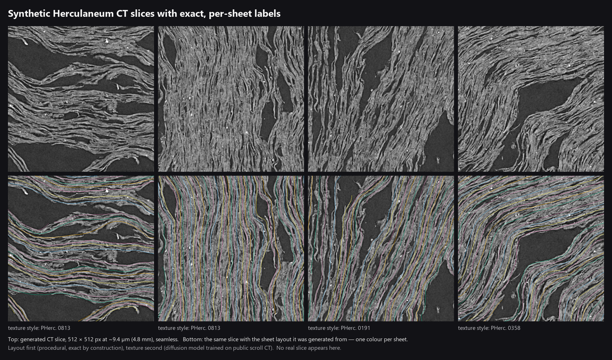

# Synthetic-Slices

**A training-data generator for Herculaneum scroll tools.** It produces CT slices that look like real ~9 µm scans of the
Herculaneum scrolls, where **every sheet is labelled exactly**, because the labels are made first and the image is generated around
them. The tiles are meant to feed tools that learn from them: sheet / surface detectors, slice tracers, instance segmentation.



*Top: generated slices, 512 × 512 px at ~9.4 µm (4.8 mm), seamless. Bottom: the same slices with the layout they were generated from,
one colour per sheet. No real slice appears in this picture.*

## How it works (two steps)

1. **Layout: procedural, exact by construction** (`synthetic_slices/layout.py`, no learning, ~0.2 s per map)
   - Settings are drawn at random: base gap between sheets 14.5–19.5 px, ±10–25 % variation from sheet to sheet, packets of
     5–16 sheets on average, gaps 1.3–2.4 × larger between packets.
   - Sheets start as a flat stack in an "unfolded" plane, then get:
     - lens-shaped voids (32–70 px high, 70–200 px long; neighbours bend around them);
     - pinches and fans (4–14 sheets converge to the minimum gap and reopen, or open like a V);
     - bundle shifts of 15–55 px;
     - small undulations, long waves and tears;
     - 1–3 bends (elbow, S or free curve, slope ≤ ~42°).
   - Every deformation is a bijection and a minimum gap of 9 px is enforced in the image, so **sheets never cross**.
   - The median line of each sheet is rasterised (1 px) with **its own id**. The map is drawn with a margin and cropped, so lines
     run to the tile edges.
   - Sheet spacing is calibrated on real m7 surface-prediction slices: 5th / 50th / 95th percentile spacing of
     4.75 / 7.75 / 16 px at 18.7 µm/px. Our layouts give 4.5 / 7.25 / 17.75.
2. **Texture: conditional diffusion model** (`synthetic_slices/model.py`, `sampler.py`)
   - The network is an EDM U-Net (Karras et al. 2022), ~36 M parameters, with self-attention at 32×32 and 16×16.
   - It was trained on **real pairs**: 256 × 256 tiles of public ~9 µm CT from 9 scrolls, each with its m7 surface prediction as
     the layout. 30 % of batches came from Paris 4, whose sheet labels are exact.
   - Training: noise of random strength σ is added to a real tile, and the network learns to recover the clean tile from σ, the
     layout and the scroll "style". It learns where papyrus is bright (on the lines), where gaps are dark, and each scroll's texture.
   - The input condition has 3 channels per pixel: the map, the line (±1), and the distance to the nearest line (clipped at 32 px).
   - Sampling: start from pure noise (σ = 80) and take 32 Heun steps down to σ = 0.002 (Karras schedule), with a little fresh
     noise at each step ("churn" 30). That churn brought a real-vs-generated classifier from 62 % down to 47 % (50 % =
     indistinguishable).
   - **Seamless canvases** (MultiDiffusion, Bar-Tal et al. 2023): at every step, overlapping 256 px windows (stride 128) are
     denoised and blended with a Hann weight.

## What you get

`python generate.py` writes `shard_XXXX.npz` files ready for training, plus optional PNG previews (no text on the tiles):

| key | type | content |
|---|---|---|
| `image` | uint8 (N, H, W) | generated CT slice |
| `lines` | uint8 (N, H, W) | 1-px median line of every sheet (0/1) |
| `sheet_id` | uint16 (N, H, W) | 0 = no line, k = sheet k (instance labels) |
| `dist` | uint8 (N, H, W) | distance to the nearest line, in px (clipped at 255) |
| `style` | int (N,) | texture style (index into `synthetic_slices.STYLES`) |

```bash
pip install -r requirements.txt
python generate.py --n 1000 --size 256 --out tiles256          # training tiles (cheapest per pixel)
python generate.py --n 20 --size 512 --out canvases --png       # seamless 512 px canvases + PNG previews
python generate.py --n 100 --style PHerc0813 --out t0813        # imitate one scroll's texture
```

The weights (145 MB, safetensors) are downloaded from Hugging Face on first use:
[huggingface.co/vincentl065/Synthetic-Slices](https://huggingface.co/vincentl065/Synthetic-Slices).

**Tile size.**
- 256 px is the native size: one window, the cheapest per pixel. Use it for intensive training.
- 384 px (4 windows) and 512 px (9 windows) give more context, at 1.8× and 2.25× the cost per pixel.
- Sizes must be multiples of 128.

### Speed (measured on an AMD RX 7800 XT, 16 GB, ROCm on Windows, 32 steps)

| tile | fp16 | bf16 |
|---|---|---|
| 256 × 256 (training tile) | **1.1 s** per tile (32 tiles in 38 s with `generate.py`, warm-up included) | 1.6 s |
| 512 × 512 (seamless canvas) | **9.5 s** per canvas | 15.3 s |

That is roughly 3,000 training tiles per hour on one consumer GPU. Times are after the first batch; the first batch is slower
because the GPU libraries tune themselves.
- fp16 gives the same images as bf16: on this GPU, with the same seed, mean absolute difference 0.15 grey level out of 255,
  correlation 0.9999.
- `generate.py` picks the precision automatically: fp16 on AMD (faster there), bf16 on NVIDIA Ampere and newer.

## Train your own / fine-tune ours

Everything used to train the released model is in `training/`.

- `extraire.py` rebuilds the real training pairs from the public bucket (`s3://vesuvius-challenge-open-data`, no login needed).
- `entrainer.py` trains with the exact released recipe: bf16, batch 24, lr 2e-4, EMA 0.9995. The released weights are the EMA at
  step 6 655, about 40 min on an RTX 5090.
- `juges.py` holds the 3 judges:
  - realism: a real-vs-generated classifier, 50 % = indistinguishable;
  - layout fidelity: a sheet detector trained on real tiles only;
  - no copying: nearest training tile.
- To fine-tune from our weights (on another scroll, other slicing axes…):
  `INIT_WEIGHTS=synthetic_slices_ema_6655.safetensors python training/entrainer.py`.

The training code still has French names and log messages (it is the research code as it ran). PRs that translate it are welcome.

## Honest limits

- **Exact:** the layout. **Learned, so approximate:** the papyrus under each line, because the training layouts were m7 surface
  predictions, which do not sit exactly on the sheets.
  - A sheet detector trained on real slices finds our lines in generated slices about as well as it finds m7 lines in real ones:
    F1 at 2 px, 0.36–0.43 vs 0.38.
- **Invented by the model:** fine strands between two lines, texture and debris.
- **Not simulated yet:** hairpins (sheets folding back), spiral centres, cracks crossing many sheets, frayed sheet ends. This is
  the first item on the roadmap.
- 2D slices only (z-slices or slices along the scroll axis). No 3D volumes yet.

## Roadmap (PRs welcome)

- [ ] Hairpins, spirals, cracks, frayed ends in the layout simulator.
- [ ] Reference training script plus benchmark: a sheet detector trained on synthetic only vs on real vs on both, scored on
  held-out real labels.
- [ ] Faster sampling (fewer steps, distillation), checked with the judges.
- [ ] 3D volumes.
- [ ] Better AMD / ROCm performance.

## Credits and licences

- Inspired by posts shared by stokarz and dreamskid on the Vesuvius Challenge Discord. Thanks to them!
- CT data and m7 surface predictions: [Vesuvius Challenge](https://scrollprize.org/data), CC BY-NC 4.0.
- Paris 4 belongs to the EduceLab-Scrolls dataset (© EduceLab / University of Kentucky, used by permission granted to the
  Vesuvius Challenge). No real data is redistributed here.
- Methods: EDM (Karras et al., 2022), MultiDiffusion (Bar-Tal et al., 2023).
- **Code:** MIT (see `LICENSE`). **Weights and generated tiles:** CC BY-NC 4.0, because they derive from the Vesuvius Challenge
  data. Non-commercial use, with attribution.

Author: vincentl065.
