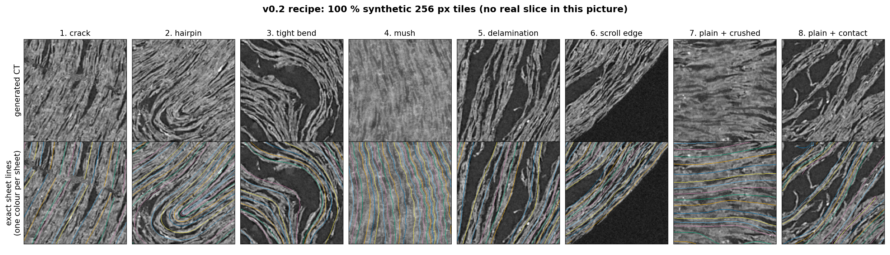
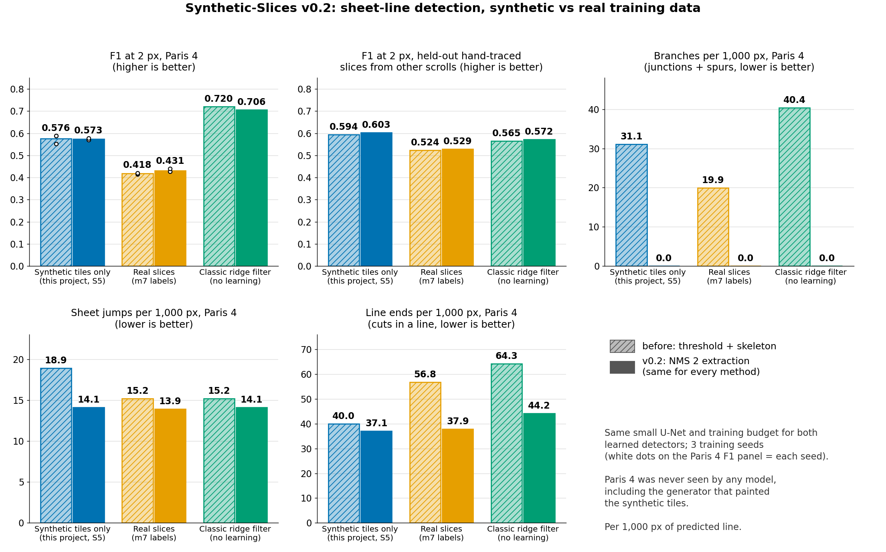
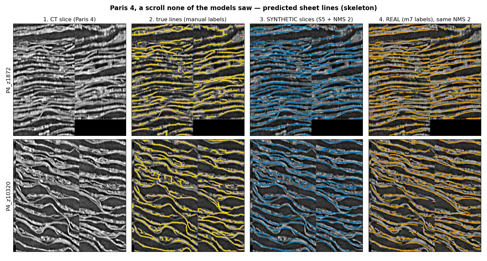

# Synthetic-Slices

**A training-data generator for Herculaneum scroll tools, and a sheet-line detector trained on its output.** It produces CT slices that
look like real ~9 µm scans of the Herculaneum scrolls, where **every sheet is labelled exactly**, because the labels are made first and
the image is generated around them. The tiles are meant to feed tools that learn from them: sheet / surface detectors, slice tracers,
instance segmentation.



*v0.2 recipe, 256 px tiles at ~9.4 µm. Top: generated slices. Bottom: the exact sheet lines they were generated from, one colour per
sheet. No real slice appears in this picture.*

## What's new in v0.2

- **Harder layouts:** hairpins, tight U folds and bends, accordion folds, cracks that cut and offset the sheets, crushed "mush",
  delamination, scroll edges with frayed last sheets, sheets pressed into contact, mineral inclusions, debris. Labels stay exact.
- **A generator retrained without any Paris 4 data**, so Paris 4 can serve as a fair test. It is the default in v0.2.
- **A sheet-line detector trained on synthetic tiles only** (weights for 3 training seeds).
- **NMS 2 line extraction:** one line per sheet, no branches, no bridges between neighbouring sheets.
- **A command-line tool**, `synthetic-slices generate` / `synthetic-slices detect`, installable with pip.

See `CHANGELOG.md` for the details.

## Install and use

```bash
pip install git+https://github.com/vincentl065/Synthetic-Slices       # or, in a clone: pip install .
synthetic-slices generate --n 1000 --size 256 --out tiles256           # training tiles, v0.2 recipe
synthetic-slices generate --n 20 --size 512 --out canvases --png        # seamless 512 px canvases + PNG previews
synthetic-slices detect my_slice.tif --out lines                        # detector + NMS 2 -> one line per sheet, no branches
synthetic-slices detect tiles256/shard_0000.npz --index 3 --out check   # on a generated tile: also prints F1 against the exact labels
```

- The weights are downloaded from Hugging Face on first use and cached:
  [huggingface.co/vincentl065/Synthetic-Slices](https://huggingface.co/vincentl065/Synthetic-Slices).
  You can also pass a local file with `--weights path/to/file.safetensors`.
- `python -m synthetic_slices ...` works too, and `python generate.py ...` is kept from v0.1. Its defaults are now the v0.2 recipe and
  generator; use `--recipe v0.1 --weights v0.1` for the v0.1 behaviour.
- `--device cpu` / `cuda` is picked automatically; `--threads N` sets the CPU threads. `synthetic-slices <command> --help` lists every
  option.

### `generate`

It writes `shard_XXXX.npz` files ready for training, plus optional PNG previews (no text on the tiles):

| key | type | content |
|---|---|---|
| `image` | uint8 (N, H, W) | generated CT slice |
| `lines` | uint8 (N, H, W) | 1-px median line of every sheet (0/1) |
| `sheet_id` | uint16 (N, H, W) | 0 = no line, k = sheet k (instance labels) |
| `dist` | uint8 (N, H, W) | distance to the nearest line, in px (clipped at 255) |
| `style` | int (N,) | texture style (index into `synthetic_slices.STYLES`; `NS` = "unknown") |
| `kind` | str (N,) | layout kind: `plain`, `hairpin`, `tight_U`, `tight_bend`, `accordion`, `crack`, `mush`, `delamination`, `scroll_edge`, with `_compact`, `+contact`, `+crushed` |
| `crack` | uint8 (N, H, W) | crack mask (0/1) |
| `crushed` | uint8 (N,) | 0 = no, 1 = whole tile, 2 = a patch |
| `guidance`, `inclusions`, `debris` | (N,) | guidance used, number of inclusions / debris clusters painted |

- **Tile size:** 256 px is the native size (one window) and the cheapest per pixel. 384 and 512 px give more context; sizes must be
  multiples of 128.
- **Style:** `--style random` (default) picks one of the scrolls the texture model learned; `--style unknown` gives a generic texture.

### `detect`

- **Input:** a 2D slice (`.png`, `.jpg`, `.tif`, `.npy`), or a tile of a generated `.npz`.
- **Scale:** the detector works at ~9.4 µm/px. Give `--voxel-um` for other scans and the slice is resampled.
- **Output:** `<name>_lines.png` (the lines, 255), `<name>_prob.png` (the detector map), `<name>_overlay.png` (lines in yellow on the
  darkened slice), and `<name>.npz` (map + lines).
- **Printed:** junction count (always 0 after NMS 2), number of line ends, and F1 against the exact labels when the input is a generated
  tile.
- **Optional:** `--mask` limits the extraction to an area.

### Speed

| task | device | time |
|---|---|---|
| `generate`, 256 px tile, 32 steps | CPU (8 threads, desktop PC) | 34 s per tile |
| `generate`, 256 px tile, 32 steps | AMD RX 7800 XT, fp16 (v0.1 measurement) | 1.1 s per tile |
| `generate`, 512 px seamless canvas | AMD RX 7800 XT, fp16 (v0.1 measurement) | 9.5 s per canvas |
| `detect`, 256 px tile | CPU | 0.2 s (+ ~3 s start-up) |
| `detect`, 1,730 × 2,596 px slice | CPU | 11 s detector + 3 s NMS 2 |

Fold and hard-case layouts are sampled with classifier-free guidance 1.6, which costs two network calls per step instead of one.

## Benchmark: is synthetic training data useful?

The test is sheet-line detection, the building block of a tracer.

- **Setup:**
  - The same small 2D U-Net (~1.3 M parameters), the same number of steps and the same augmentation are used for every learned arm.
  - 3 training seeds per arm.
  - The best step is chosen on 56 held-out real tiles, never on test slices.
- **Arms:**
  - synthetic only: 2,000 tiles of the v0.2 recipe, painted by the generator trained without Paris 4;
  - real only: 320 real 9 µm tiles labelled with the centre line of the public m7 surface prediction;
  - a classic ridge filter, with no learning.
- **Test sets:**
  - **PHerc Paris 4**, from the public manual volumetric instance labels: 6 stitched slices, never seen by any model, including the
    generator;
  - held-out slices from other scrolls where every sheet was traced by hand.
- **Metric:** F1 between the predicted lines and the true centre lines at 2 px. The other counts are per 1,000 px of predicted line.



| detector | extraction | F1 @ 2 px, Paris 4 | F1 @ 2 px, hand-traced | sheet jumps | junctions | spurs | line ends |
|---|---|---|---|---|---|---|---|
| **synthetic tiles only** | threshold + skeleton | 0.576 ± 0.017 | 0.594 | 18.9 | 19.4 | 11.7 | 40.0 |
| **synthetic tiles only** | **NMS 2** | **0.573 ± 0.003** | **0.603** | 14.1 | 0 | 0 | 37.1 |
| real slices, m7 labels | threshold + skeleton | 0.418 ± 0.003 | 0.524 | 15.2 | 11.8 | 8.1 | 56.8 |
| real slices, m7 labels | NMS 2 | 0.431 ± 0.006 | 0.529 | 13.9 | 0 | 0 | 37.9 |
| classic ridge filter | threshold + skeleton | **0.720** | 0.565 | 15.2 | 21.1 | 19.3 | 64.3 |
| classic ridge filter | NMS 2 | 0.706 | 0.572 | 14.1 | 0 | 0 | 44.2 |

± = standard deviation over the 3 training seeds.



What the numbers say:
- With the same extraction, the detector trained on synthetic tiles beats the same detector trained on real slices with m7 labels:
  +0.14 F1 on Paris 4, +0.07 on the hand-traced slices.
- **The classic ridge filter is still the best on Paris 4** (0.706 with NMS 2). It is behind on the hand-traced slices.
- NMS 2 removes every junction and spur for every method, at the same F1. Its settings were frozen on a tuning set (held-out real tiles
  plus held-out synthetic tiles), never on test slices.
- Sheet jumps drop from 18.9 to 14.1 per 1,000 px with NMS 2, about the level of the real-data detector (13.9), not below.

## How it works

1. **Layout: procedural, exact by construction** (`layout.py`, plus `folds.py`, `hard_cases.py`, `cracks.py`, `phenomena.py`,
   `v3.py`; no learning)
   - **Plain stacks (v0.1):** packets of sheets, lens-shaped voids, pinches and fans, bundle shifts, undulations, tears and 1–3 bends.
     Every deformation is a bijection and a minimum gap of 9 px is enforced, so sheets never cross.
   - **Folds:** hairpin, tight U, tight bend, accordion, sometimes "compact" (sheets packed near the minimum gap).
   - **Hard cases:**
     - crack: a jagged break with notches, the fault turned 4–22°, width 0–12 px; sheets are cut and offset;
     - mush: crushed sheets;
     - delamination.
   - **Extras:** scroll edge with frayed last sheets, sheets pressed into contact (3–8 px).
   - **Shares in the v0.2 recipe (`v3.RECIPE_S5`):** 50 % plain (8 % of them scroll edges), 25 % folds, 25 % hard cases.
   - Sheet spacing is calibrated on real m7 surface-prediction slices (5th / 50th / 95th percentile 4.75 / 7.75 / 16 px at 18.7 µm/px).
2. **Texture: conditional diffusion model** (`model.py`, `sampler.py`)
   - **Network:** an EDM U-Net (Karras et al. 2022), ~36 M parameters.
   - **Training data:** real pairs, i.e. 256 px tiles of public ~9 µm scroll CT with their m7 surface prediction as the layout.
   - **Condition:** the lines, the distance to the nearest line, and a texture style.
   - **Sampling:** 32 Heun steps with a little fresh noise ("churn"); classifier-free guidance 1.6 for folds and hard cases.
   - **Seamless large canvases** (MultiDiffusion, Bar-Tal et al. 2023): overlapping 256 px windows blended at every step.
3. **Painted after the model, without moving any line** (`cracks.py`, `phenomena.py`)
   - the crushed look (blur across sheets, local contrast × 0.55–0.8, grain);
   - the crack opening, painted with the tile's own air grey;
   - the air beyond a scroll edge;
   - bright mineral inclusions and debris.
4. **Detector and NMS 2** (`detector.py`, `extract.py`)
   - The detector is a small U-Net. Each 256 px window is normalised by its own percentiles, so the input grey range does not matter.
   - NMS 2 keeps a pixel only if the map is a maximum across the sheet. It searches along the stroke's own normal, with a 45° gate
     against the large-scale sheet normal, so a bridge, which runs across the sheets, is rejected.
   - It then applies hysteresis at the Otsu threshold, prunes spurs, and closes gaps ≤ 6 px between line ends that face each other.

## Train your own / fine-tune ours

Everything used to train the v0.1 generator is in `training/`. The v0.2 generator uses the same recipe without Paris 4.

- `extraire.py` rebuilds the real training pairs from the public bucket (`s3://vesuvius-challenge-open-data`, no login needed).
- `entrainer.py` trains with the released recipe: bf16, batch 24, lr 2e-4, EMA 0.9995.
- `juges.py` holds the 3 judges: realism (real-vs-generated classifier), layout fidelity, no copying.
- **Fine-tuning from our weights:** `INIT_WEIGHTS=synthetic_slices_ema_6655.safetensors python training/entrainer.py`.
- **Caveat:** this is the research code as it ran on a cloud GPU pod. It still has French names and log messages. Issues and PRs are
  welcome.
- **Not released:** the detector training script.

## Honest limits

- **In crushed regions, NMS 2 still draws short oriented strokes.** They have no branches, but they are not followed sheets.
- **Synthetic cracks are often too thin**, and synthetic crushed regions are too smooth / blurry compared with real ones.
- **A classic ridge filter is still better on Paris 4.**
- **Exact:** the layout. **Learned, so approximate:** the papyrus under each line, because the generator's training layouts were m7
  predictions. The model also invents fine strands, texture and debris.
- 2D slices only. No spiral centres and no 3D volumes yet.

## Roadmap (PRs welcome)

- [ ] Wider, sharper cracks and grainier crushed regions, checked against real ones.
- [ ] Fewer sheet jumps: separate tightly packed sheets.
- [ ] Spiral centres, 3D volumes.
- [ ] Faster sampling (fewer steps, distillation), checked with the judges.

## Credits and licences

- Inspired by posts shared by stokarz and dreamskid on the Vesuvius Challenge Discord. Thanks to them!
- CT data and m7 surface predictions: [Vesuvius Challenge](https://scrollprize.org/data), CC BY-NC 4.0.
- Paris 4 belongs to the EduceLab-Scrolls dataset (© EduceLab / University of Kentucky, used by permission granted to the
  Vesuvius Challenge). No real data is redistributed here.
- Methods: EDM (Karras et al., 2022), MultiDiffusion (Bar-Tal et al., 2023).
- **Code:** MIT (see `LICENSE`). **Weights and generated tiles:** CC BY-NC 4.0, because they derive from the Vesuvius Challenge data.
  Non-commercial use, with attribution.

Author: vincentl065.
