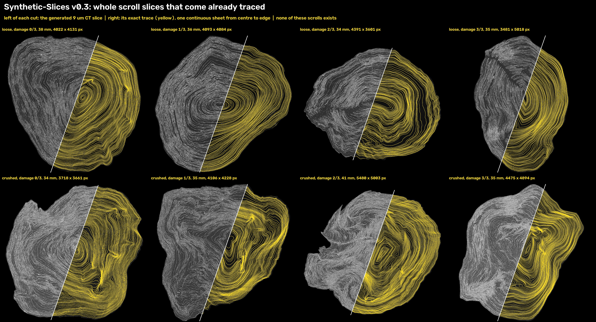
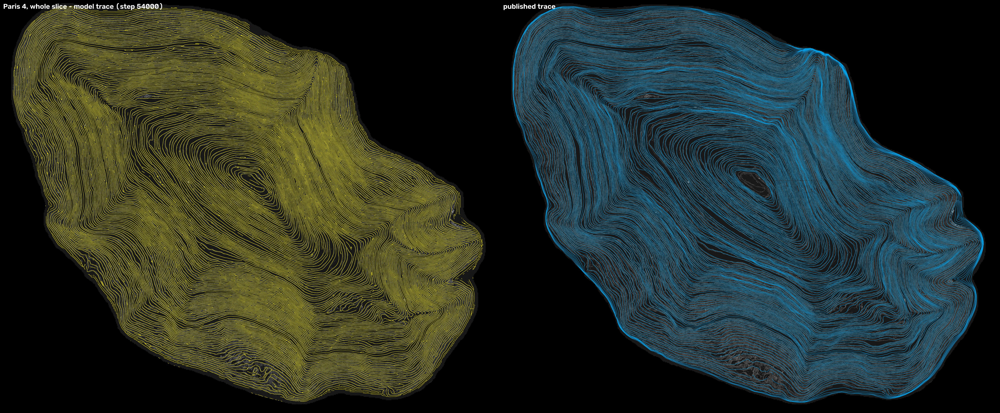
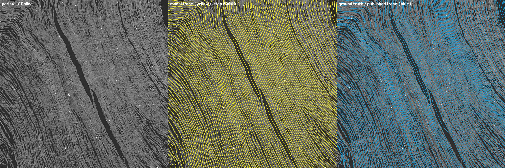

# Whole scroll slices (v0.3)

v0.1 and v0.2 generate **tiles**. v0.3 generates **whole scroll cross-sections that come already traced**, at ~9 µm: one continuous sheet wound from the centre
to the edge, 24 to 50 mm across (about 3,000 to 6,500 px on a side), with the exact answer for every pixel.



*Left of each cut: the generated CT slice. Right: its exact trace.*

None of these scrolls exists. The shape is computed first (a winding field), the image is painted around it by the diffusion
generator, so the labels are exact by construction.

## The dataset: 500 slices, ready to use

[huggingface.co/datasets/vincentl065/synthetic-scroll-slices](https://huggingface.co/datasets/vincentl065/synthetic-scroll-slices)
(19.8 GB, CC BY-NC 4.0).

Each slice `cNNNN` is two files:

| file | content |
|---|---|
| `coupes/cNNNN.png` | the slice, 8-bit, ~9 µm per pixel, black outside the scroll |
| `coupes/cNNNN.npz` | the ground truth (see below) |

| key in the `.npz` | what it is |
|---|---|
| `lig` | the sheet centre lines, **continuous through cracks and missing parts** (bit-packed, `np.unpackbits(z["lig"], axis=-1)[:, :W]`) |
| `ph8` | phase between two sheets, 0 on a sheet and growing to 255 just before the next one |
| `U2` | winding number (turn count from the centre), float32, half resolution, -1 outside |
| `ded` | inside-the-scroll mask (bit-packed) |
| `cassure` | where the image is broken (cracks, torn sheets, holes): the trace still runs through, but there is nothing to see (bit-packed) |
| `vis` | the trace actually given to the painter, i.e. broken where the image is broken (bit-packed) |
| `plages` | map of the areas painted as crushed "mush" |
| `meta` | JSON: size and all shape parameters; `meta["lot"]["tirage"]` holds `FAM` (`lache` = loose, `ecrase` = crushed), `DEG` (damage level 0 to 3) and `DMM` (diameter in mm) |

The mix: 40 % loose scrolls, 60 % crushed; damage level 0 (intact) 25 %, 1: 30 %, 2: 30 %, 3 (badly damaged) 15 %; diameters drawn
between 24 and 50 mm, most around 38 mm. The slice number seeds everything, so any slice can be regenerated.

```python
import numpy as np, cv2, json
from huggingface_hub import hf_hub_download
R = "vincentl065/synthetic-scroll-slices"
img = cv2.imread(hf_hub_download(R, "coupes/c1003.png", repo_type="dataset"), 0)
z = np.load(hf_hub_download(R, "coupes/c1003.npz", repo_type="dataset"))
H, W = img.shape
lines = np.unpackbits(z["lig"], axis=-1)[:, :W] > 0          # exact sheet lines
inside = np.unpackbits(z["ded"], axis=-1)[:, :W] > 0
phase = z["ph8"]                                             # 0..255 between two sheets
turn = cv2.resize(z["U2"], (W, H))                           # winding number
meta = json.loads(str(z["meta"]))                         # meta["lot"]["tirage"]: FAM, DEG, DMM
```

## Make your own slices

`generator/` is the working tree that produced the 500 slices, as is. It is self-contained (it carries its own copy of the
`synthetic_slices` package with the faster whole-slice sampler). Code comments are in French.

```bash
cd whole_slices/generator
bash installer.sh                                      # numpy, scipy, opencv, scikit-image, huggingface_hub (torch with CUDA must be there)
# painter weights (146 MB), from the dataset repository:
python -c "from huggingface_hub import hf_hub_download as d; import shutil; shutil.copy(d('vincentl065/synthetic-scroll-slices','generator/ema_affine_p02000.pt',repo_type='dataset'),'ema_affine_p02000.pt')"
python lot.py out 2000 100 0 2 24 50                   # 100 slices numbered 2000..2099 on GPU 0, 2 shapes in parallel, 24-50 mm
python lot.py out 2000 500 0,1,2,3 8                   # 4 GPUs
```

- Output: `out/final/cN.png` + `cN.npz`, and one line per slice in `out/journal.txt`. Re-running the same command resumes.
- `FAMILLE=lache|ecrase` and `DEGATS=0..3` force the family and the damage level.
- Three steps per slice: **shape** (`pod/geom_v7.py`, CPU plus a little GPU, 20 s to 4 min, up to 35 GB of RAM for the largest
  scrolls: use a 64 GB machine), **painting** (`local_v7/peindre_masse.py`, about 9 s per megapixel on an RTX 4090, i.e. 1.5 to
  5 min), **finishing** (motion blur, tone of a real scroll taken from a 202-number profile, inclusions, edge).
- Measured cost on rented RTX 4090s: about 22 slices per hour per card, 2 to 3 US cents per slice.
- Cracks are made by breaking the **trace given to the painter** (`casser_trace_entier.py`), not by drawing on the image: the
  painter itself paints the torn edges. The ground truth stays continuous.

## A first baseline tracer

`baseline_tracer/` is a first attempt at the thing these slices are made for: a model that traces a whole real slice. It is a
small U-Net (12 M parameters) that looks at 512 px crops and predicts the sheet lines, the phase between sheets, and the direction
and density of the winding. Weights: `baseline/` in the dataset repository.



*Paris 4 (PHerc. Paris 4), one whole slice. Left: the baseline's trace. Right: the published unrolling cut by the same plane.*



Training data: 496 synthetic slices **plus 32 real slices of Paris 4** taken at least 6 mm away from the slice shown here (only the
spacing between consecutive published wraps is taught on them, never the exact line position). So this is not a synthetic-only
result, and Paris 4 is not an unseen scroll for this model.

What it does, measured on held-out slices (F1 = agreement of the traced lines with the truth, within 2 px on synthetic slices and
3 px against the published trace of Paris 4):

| held-out slice | F1 | line ends per megapixel | truth lines found inside cracks and holes |
|---|---|---|---|
| synthetic, loose, intact | 0.81 | 84 | n/a |
| synthetic, loose, badly damaged | 0.70 | 272 | 47 % |
| synthetic, crushed | 0.63 to 0.68 | 294 to 312 | 41 % |
| Paris 4 (real) | 0.52 | 171 | n/a |

**Honest limits.** It is a good sheet detector where the sheets are separated, on synthetic and on real data. It is not an
unrolling tool:

- tightly packed zones are traced poorly, with broken lines and lines that turn back on themselves;
- the published trace of Paris 4 is smooth and sits about 2 px from the sheets, so 0.52 underrates the model there, but half of its
  lines in the dense zones are still off;
- putting the predictions together into one winding number for the whole slice gives the right turn within half a turn on only
  about 11 % of Paris 4.

What moved the scores during this first run was never more steps (nothing changed between 15,000 and 60,000 steps): it was giving
the model the distance to the winding centre, adding real slices, and sampling the dense zones more often. Ideas worth trying next:
a model that sees wider than 512 px, neighbouring slices along the scroll axis as input, more traced real slices, and a real sheet
count instead of a density estimate.

```bash
cd whole_slices/baseline_tracer
python preparer.py work &            # downloads the dataset slices and turns them into arrays (runs in a loop)
python centres.py work &             # adds the winding centre of each slice
TEMOINS=c1321,c1316,c1305,c1300 python entrainer.py work 60000 10
```

(`TEMOINS` = held-out slices. A Paris 4 witness slice is expected in `work/temoins/` if you want the real-data check; the code runs
without it.)
